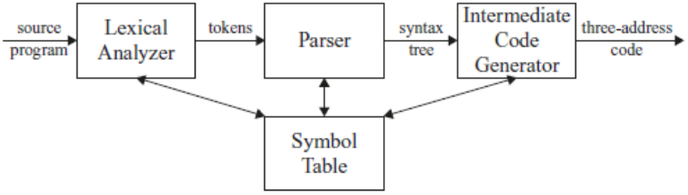

The first phase of a compiler is called lexical analysis or scanning. The
lexical analyzer reads the stream of characters making up the source
program and groups the characters into meaningful sequences called
lexemes. For each lexeme, the lexical analyzer produces as output a token
of the form:

```text
<token-name, attribute-value>
```

In the token, the first component token-name is an abstract symbol that is used during syntax
analysis, and the second component attribute-value points to an entry in the
symbol table for this token. Information from the symbol-table entry is
needed for semantic analysis and code generation.


